# Dungeon

## 1. Descripción general

La dungeon se encuentra dentro de la dimensión **Tierras Profundas** y está formada por diferentes salas y niveles de dificultad.

El jugador debe superar los enemigos de cada sala para poder continuar. El sistema utiliza barreras invisibles que impiden avanzar hasta completar los desafíos correspondientes.

El jugador debe avanzar por las distintas salas, derrotar a los enemigos y conseguir las **dos tarjetas amarillas** necesarias para fabricar la **tarjeta roja**.

La tarjeta roja permite acceder a la zona donde se encuentra **MR Mullet**.

---

## 2. Diseño de la dungeon

La dungeon estará formada por:

- Una entrada.
- Dos salas paralelas de loot.
- Sala de enemigo.
- Altar a Cloude Code con una tarjeta amarilla.
- Un laberinto.
- Sala de enemigos
- Altar a Diego Vera con una tarjeta amarilla
- Por el laberinto se accede a la sala del jefe.
- Sala del jefe.
- Una salida.
---

### Diagrama/Mapa:

```mermaid
flowchart TD
    classDef spawn fill:#4a154b,stroke:#a855f7,stroke-width:2px,color:#fff;
    classDef supply fill:#2d3748,stroke:#cbd5e0,stroke-width:2px,color:#fff;
    classDef warped fill:#0d3b43,stroke:#14b8a6,stroke-width:2px,color:#fff;
    classDef crimson fill:#4a1525,stroke:#ef4444,stroke-width:2px,color:#fff;
    classDef maze fill:#3b3a30,stroke:#eab308,stroke-width:2px,color:#fff;
    classDef boss fill:#1f2937,stroke:#dc2626,stroke-width:2px,color:#fff;
    classDef exit fill:#111827,stroke:#22c55e,stroke-width:2px,color:#fff;

    Start(["Pozo Overworld + Moneda"]):::spawn --> Spawn["Sala de Entrada (Spawn Amatista)<br/><i>X: 261, Y: 29, Z: 35</i>"]:::spawn
    Spawn --> Barriles["Sala de Barriles (216 Barriles de Suministros)<br/><i>X: [212..237], Z: [4..65]</i>"]:::supply
    
    Barriles --> F1N1["Fase 1 - Nivel 1 (Azul / Warped)<br/>8 Zombies, 5 Esqueletos"]:::warped
    F1N1 -->|Eliminar enemigos| GateF1N1["Barrera GATE_F1_N1 desaparece<br/><i>Muro en X = 160</i>"]
    GateF1N1 --> F1N2["Fase 1 - Nivel 2<br/>12 Zombies (4 hierro), 7 Esqueletos (3 arco)"]:::warped
    F1N2 -->|Eliminar enemigos| GateF1N2["Barrera GATE_F1_N2 desaparece<br/><i>Puerta en Z = 60</i>"]
    GateF1N2 --> F1N3["Fase 1 - Nivel 3<br/>18 Zombies (6 hierro, 2 diamante), 10 Esqueletos"]:::warped
    F1N3 -->|Eliminar enemigos| GateF1N3["Barrera GATE_F1_N3 desaparece"]
    GateF1N3 --> Chest1["Cofre 1 en (149, 30, 70)<br/>★ 1ª TARJETA AMARILLA ★"]:::warped

    GateF1N3 --> Laberinto["Laberinto Central (Deepslate)<br/><i>X: [71..130], Z: [15..58]</i><br/>(Barrera en X = 71 desbloqueada)"]:::maze
    Laberinto --> F2N1["Fase 2 - Nivel 1 (Rojo / Crimson)<br/>12 Zombies (4 hierro), 8 Esqueletos"]:::crimson
    F2N1 -->|Eliminar enemigos| GateF2N1["Barrera GATE_F2_N1 desaparece<br/><i>Muro en X = 41</i>"]
    GateF2N1 --> F2N2["Fase 2 - Nivel 2<br/>16 Zombies (6 hierro), 10 Esqueletos (5 empuje)"]:::crimson
    F2N2 -->|Eliminar enemigos| GateF2N2["Barrera GATE_F2_N2 desaparece<br/><i>Puerta en Z = 60</i>"]
    GateF2N2 --> F2N3["Fase 2 - Nivel 3<br/>20 Zombies (8 hierro, 3 diamante), 12 Esqueletos"]:::crimson
    F2N3 -->|Eliminar enemigos| GateF2N3["Barrera GATE_F2_N3 desaparece"]
    GateF2N3 --> Chest2["Cofre 2 en (40, 30, 71)<br/>★ 2ª TARJETA AMARILLA ★"]:::crimson

    Chest1 & Chest2 --> Craft["CRAFTEO: 2 Tarjetas Amarillas ➔ TARJETA ROJA"]
    Craft --> RedDoor1["Puerta Roja 1 (Lana roja, 36 bloques)<br/><i>X: [100..103], Z: 44</i><br/>(Clic derecho con Tarjeta Roja)"]:::boss
    Laberinto -.->|Acceso físico norte| RedDoor1
    
    RedDoor1 --> RedCorridor["Pasillo Rojo Decorativo<br/><i>X: [98..105], Z: [45..60]</i>"]:::boss
    RedCorridor --> BossRoom["Arena Circular de Combate (Mr. Mullet)<br/><i>Centro: (102, 28, 106) | Radio ~35m</i>"]:::boss
    BossRoom -->|Derrotar a Mr. Mullet| RedDoor2["Puerta Roja 2 (Lana roja, 54 bloques)<br/><i>X: [99..104], Z: 151</i><br/>(Se desbloquea al morir el jefe)"]:::boss
    
    RedDoor2 --> FinalRoom["Habitación Negra (Sala de Victoria)<br/><i>X: [65..140], Z: [152..190]</i>"]:::exit
    FinalRoom --> MulletBlock["Bloque de Retorno (Mullet Block)<br/><i>Posición: (101, 28, 180)</i><br/>Clic derecho"]:::exit
    MulletBlock --> ExitOverworld(["Retorno al Overworld + Rescate del Profesor"]):::exit
```



### Funcionamiento de las salas

Cada sala cuenta con un sistema de seguimiento de enemigos restantes.

Mientras existan enemigos en la sala, el jugador no puede avanzar a través de la barrera correspondiente.

Cuando todos los enemigos son derrotados, se toma la sala como completada, y permite continuar el recorrido.

Las barreras se utilizan para mantener el orden de avance y evitar que el jugador avance directamente hacia las siguientes zonas.

# 3. Fase 1

La Fase 1 está dividida en tres niveles de dificultad.

## Nivel 1

| Enemigo | Cantidad |
|---|---:|
| Zombies | 8 |
| Esqueletos | 5 |

No se especifican armaduras o armas especiales para este nivel.

## Nivel 2

| Enemigo | Cantidad | Características |
|---|---:|---|
| Zombies | 12 | 4 con armadura de hierro |
| Esqueletos | 7 | 3 con arco encantado |

## Nivel 3

| Enemigo | Cantidad | Características |
|---|---:|---|
| Zombies | 16 | 6 con armadura de hierro |
| Esqueletos | 10 | 4 con arco encantado |
| Zombies | 2 | Armadura de diamante |

Al completar la Fase 1 se obtiene una **tarjeta amarilla**.

---

# 4. Fase 2

La Fase 2 aumenta la cantidad y dificultad de los enemigos.

## Nivel 1

| Enemigo | Cantidad | Características |
|---|---:|---|
| Zombies | 12 | 4 con armadura de hierro |
| Esqueletos | 8 | — |

## Nivel 2

| Enemigo | Cantidad | Características |
|---|---:|---|
| Zombies | 16 | 6 con armadura de hierro |
| Esqueletos | 10 | 5 con arco encantado con Empuje 3 |

## Nivel 3

| Enemigo | Cantidad | Características |
|---|---:|---|
| Zombies | 20 | 8 con armadura de hierro, 3 con armadura de diamante |
| Esqueletos | 12 | 6 con arco encantado |

Al completar la Fase 2 se obtiene la segunda **tarjeta amarilla**.

---

# 5. Tarjetas

Las tarjetas son necesarias para avanzar dentro de la dungeon. Se consiguen en los altares repartidos en la dungeon.

## Tarjeta amarilla

Existen dos tarjetas amarillas dentro de la dungeon.

Cada una se obtiene después de superar una de las fases principales (encontrándose dentro de los dos cofres de recompensa de la dungeon, una tarjeta por cofre):

- **Cofre 1:** Ubicado tras superar la Fase 1 (contiene 1 Tarjeta Amarilla).
- **Cofre 2:** Ubicado tras superar la Fase 2 (contiene 1 Tarjeta Amarilla).

```text
Fase 1 → Cofre 1 → Tarjeta amarilla
Fase 2 → Cofre 2 → Tarjeta amarilla
```

Las dos tarjetas amarillas se utilizan para fabricar la **tarjeta roja**.

## Tarjeta roja

La tarjeta roja se fabrica utilizando las dos tarjetas amarillas y colocandolas sin orden especifico en la mesa de crafteo.

```text
Tarjeta amarilla
        +
Tarjeta amarilla
        ↓
   Tarjeta roja
```

La tarjeta roja permite acceder a la zona de **MR Mullet**.

---

# 6. MR Mullet

Después de conseguir la tarjeta roja, el jugador puede acceder a la zona donde se encuentra MR Mullet.

MR Mullet es el jefe principal de la dungeon.

Su sala circular se encuentra después de las fases de enemigos y cuenta con una entrada y una salida.

### Características del jefe

- Altura aumentada.
- Alta resistencia.
- Ataques a distancia y cuerpo a cuerpo.
- Proyectiles especiales.
- Estado de Frenesí de manera aleatroria.
- Aparición de Conejos asesinos ("Camejitos").
- Cada dos golpes seguidos al jugadores, da el efecto de wither.

Los ataques y estadísticas exactas del jefe se definirán en la documentación correspondiente al jefe.

---

# 7. Loot

El loot de suministros y recompensas generales se encuentra distribuido en los **barriles** de la sala de barriles, mientras que los **dos cofres** principales contienen las **Tarjetas Amarillas** de progresión (una por cofre).

### Características del loot en barriles:
- **Tiradas mínimas garantizadas:** Cada barril genera entre **4 y 6 objetos** (`rolls: 4..6`), evitando que queden vacíos o semivacíos.
- **Mayor cantidad en objetos de valor:** Los minerales y recursos valiosos (que no son herramientas/armaduras) aparecen en mayores cantidades/stacks cuando se generan.
- **Herramientas y equipamiento:** Aparecen de forma individual (1 unidad).

## Tabla de loot (Barriles)

| Objeto | Cantidad por aparición | Probabilidad relativa (peso) |
|---|:---:|---:|
| 8 bloques de adoquín | 8 | 12% |
| Un solo palo | 1 | 12% |
| Tierra | 2 – 6 | 10% |
| Hilo | 1 – 3 | 9% |
| Huesos | 2 – 5 | 9% |
| Carne podrida | 2 – 5 | 9% |
| Grava | 2 – 6 | 8% |
| Papel | 2 – 5 | 8% |
| Semillas de trigo | 2 – 5 | 8% |
| Ojo de araña | 1 – 3 | 7% |
| Tinte gris | 1 – 3 | 7% |
| Un cuenco | 1 | 7% |
| Patata venenosa | 1 | 6% |
| Arena | 2 – 6 | 6% |
| Bota de cuero | 1 | 5% |
| Azada de madera | 1 | 5% |
| Manzana normal | 2 – 4 | 5% |
| Cuerda | 1 | 5% |
| Pico de hierro | 1 | 4% |
| Escudo dañado | 1 | 4% |
| Caña de pescar | 1 | 4% |
| Bloque de musgo | 2 – 6 | 4% |
| Lingote de hierro | 4 – 10 | 3% |
| Lingote de oro | 3 – 8 | 3% |
| Lingote de cobre | 6 – 16 | 3% |
| Zanahoria | 4 – 8 | 3% |
| Botella de miel | 2 – 4 | 3% |
| Armadura de hierro sin encantar | 1 | 2,5% |
| Armadura de diamante sin encantar | 1 | 1,5% |
| Espada de diamante sin encantar | 1 | 1,5% |
| Pico de diamante sin encantar | 1 | 1,5% |
| Esmeraldas | 3 – 7 | 1,5% |
| Libro encantado | 1 | 1% |
| Diamantes | 2 – 5 | 0,8% |
| Manzana dorada | 1 – 3 | 0,5% |
| Plantilla de herrería de centinela | 1 – 2 | 0,5% |
| Plantilla de herrería de dunas | 1 – 2 | 0,5% |
| Plantilla de herrería de costa | 1 – 2 | 0,5% |
| Plantilla de herrería de anfitrión | 1 – 2 | 0,2% |

---

# 8. Distribución del loot

- **Cofres principales (2):** Ubicados como recompensa al completar cada una de las fases de combate (Fase 1 y Fase 2). Cada cofre contiene una Tarjeta Amarilla indispensable para progresar hacia la sala del jefe.
- **Sala de barriles:** Gran sala de almacenamiento que concentra los barriles de la dungeon con el loot de suministros y recursos de la tabla anterior.

---

# 9. Finalizacion

Después de derrotar a MR Mullet, el jugador sera teletransportado fuera de la dungeon y junto al pozo inicial.

---

# 10. Notas de desarrollo

La dungeon debe generarse dentro de la dimensión **Tierras Profundas**.

La estructura debe respetar la distribución definida en este documento y mantener el orden de progresión establecido.

Las cantidades de enemigos, equipamiento y probabilidades de loot deben poder modificarse fácilmente durante el desarrollo para permitir ajustes de dificultad y balance.

Las características que todavía no estén definidas deberán marcarse como pendientes en lugar de asumir valores definitivos.
