# La Mazmorra (Dungeon)

Este documento contiene la especificación arquitectónica completa de la mazmorra de las **Tierras Profundas**: distribución de salas, coordenadas relativas y absolutas, equipamiento y balance de enemigos, sistema de barreras invisibles, protección anti-grief y la tabla matemática de botín.

---

## 1. Descripción General

La mazmorra es una megaestructura subterránea de ladrillos de piedra, pizarras profundas y bloques oscuros contenida en la plantilla NBT `structures/dungeon.nbt`.

Se coloca de forma automática en la dimensión de vacío `mullet:tierras_profundas` en el **origen absoluto `(0, 40, 0)`**.

> [!NOTE]
> **Sistema de Coordenadas:**  
> Todas las posiciones internas de las salas se definen mediante **desplazamientos locales** $(X, Y, Z)$ respecto al origen $(0, 40, 0)$. Para obtener la coordenada absoluta en el juego, simplemente se suma $40$ a la altura $Y$:
> $$\text{Coordenada Absoluta} = (X_{\text{local}}, Y_{\text{local}} + 40, Z_{\text{local}})$$

---

## 2. Mapa y Flujo de Progresión

```mermaid
flowchart TD
    classDef spawn fill:#4a154b,stroke:#a855f7,stroke-width:2px,color:#fff;
    classDef supply fill:#2d3748,stroke:#cbd5e0,stroke-width:2px,color:#fff;
    classDef warped fill:#0d3b43,stroke:#14b8a6,stroke-width:2px,color:#fff;
    classDef crimson fill:#4a1525,stroke:#ef4444,stroke-width:2px,color:#fff;
    classDef maze fill:#3b3a30,stroke:#eab308,stroke-width:2px,color:#fff;
    classDef boss fill:#1f2937,stroke:#dc2626,stroke-width:2px,color:#fff;
    classDef exit fill:#111827,stroke:#22c55e,stroke-width:2px,color:#fff;

    Start(["Pozo Overworld + Llave Moneda"]):::spawn --> Spawn["Sala de Entrada (Cruz de Amatista)<br/><i>Local: (261, 29, 35) | Absoluta: (261, 69, 35)</i>"]:::spawn
    Spawn --> Barriles["Sala de Barriles (216 Barriles de Suministros)<br/><i>X: [212..237], Z: [4..65]</i>"]:::supply
    
    Barriles --> F1N1["Fase 1 - Nivel 1 (Azul / Warped)<br/>8 Zombies, 5 Esqueletos"]:::warped
    F1N1 -->|Eliminar enemigos| GateF1N1["Barrera GATE_F1_N1 desaparece<br/><i>Muro en X = 160</i>"]
    GateF1N1 --> F1N2["Fase 1 - Nivel 2<br/>12 Zombies (4 con armadura de hierro), 7 Esqueletos (3 con Poder I)"]:::warped
    F1N2 -->|Eliminar enemigos| GateF1N2["Barrera GATE_F1_N2 desaparece<br/><i>Puerta en Z = 60</i>"]
    GateF1N2 --> F1N3["Fase 1 - Nivel 3<br/>18 Zombies (6 hierro, 2 diamante), 10 Esqueletos (4 con Poder II)"]:::warped
    F1N3 -->|Eliminar enemigos| GateF1N3["Barrera GATE_F1_N3 desaparece"]
    GateF1N3 --> Chest1["Cofre 1 en local (149, 30, 70)<br/>★ 1ª TARJETA AMARILLA ★"]:::warped

    GateF1N3 --> Laberinto["Laberinto Central de Deepslate<br/><i>X: [71..130], Z: [15..58]</i><br/>(Barrera en X = 71 desbloqueada)"]:::maze
    Laberinto --> F2N1["Fase 2 - Nivel 1 (Rojo / Crimson)<br/>12 Zombies (4 hierro), 8 Esqueletos"]:::crimson
    F2N1 -->|Eliminar enemigos| GateF2N1["Barrera GATE_F2_N1 desaparece<br/><i>Muro en X = 41</i>"]
    GateF2N1 --> F2N2["Fase 2 - Nivel 2<br/>16 Zombies (6 hierro), 10 Esqueletos (5 con Punch II)"]:::crimson
    F2N2 -->|Eliminar enemigos| GateF2N2["Barrera GATE_F2_N2 desaparece<br/><i>Puerta en Z = 60</i>"]
    GateF2N2 --> F2N3["Fase 2 - Nivel 3<br/>20 Zombies (8 hierro, 3 diamante), 12 Esqueletos (6 con Poder II)"]:::crimson
    F2N3 -->|Eliminar enemigos| GateF2N3["Barrera GATE_F2_N3 desaparece"]
    GateF2N3 --> Chest2["Cofre 2 en local (40, 30, 71)<br/>★ 2ª TARJETA AMARILLA ★"]:::crimson

    Chest1 & Chest2 --> Craft["CRAFTEO: 2 Tarjetas Amarillas ➔ TARJETA ROJA"]
    Craft --> RedDoor1["Puerta Roja 1 (Lana roja, 36 bloques)<br/><i>Local: X: [100..103], Z: 44</i><br/>(Clic derecho para abrir)"]:::boss
    Laberinto -.->|Acceso físico norte| RedDoor1
    
    RedDoor1 --> RedCorridor["Pasillo Rojo Decorativo<br/><i>Local: X: [98..105], Z: [45..60]</i>"]:::boss
    RedCorridor --> BossRoom["Arena Circular de Combate (Mr. Mullet)<br/><i>Centro local: (102, 28, 106) | Radio ~35m</i>"]:::boss
    BossRoom -->|Derrotar a Mr. Mullet| RedDoor2["Puerta Roja 2 (Lana roja, 54 bloques)<br/><i>Local: X: [99..104], Z: 151</i><br/>(Desbloqueada tras vencer al jefe)"]:::boss
    
    RedDoor2 --> FinalRoom["Habitación Negra (Sala de Victoria)<br/><i>Local: X: [65..140], Z: [152..190]</i>"]:::exit
    FinalRoom --> MulletBlock["Bloque de Retorno (Mullet Block)<br/><i>Posición local: (101, 28, 180)</i><br/>Clic derecho"]:::exit
    MulletBlock --> ExitOverworld(["Retorno al Overworld + Rescate del Profesor"]):::exit
```

---

## 3. Sistema de Protección Anti-Grief (`DungeonProtectionEvents`)

Para garantizar que la experiencia sea similar a un mapa de aventuras balanceado, el mod implementa un sistema estricto de protección en las Tierras Profundas:

1. **Inmunidad a la Rotura de Bloques:** Los jugadores en modo supervivencia **no pueden picar ni romper ningún bloque** que pertenezca a la estructura original de la dungeon.
2. **Registro de Bloques de Jugador (`playerPlacedBlocks`):** Los jugadores pueden colocar bloques libremente (bloques de apoyo, antorchas, etc.) y **únicamente podrán picar aquellos bloques que ellos mismos hayan colocado**.
3. **Inmunidad contra Explosiones:** Si explota un creeper, una dinamita o una tarjeta explosiva, la estructura original no sufre daños (`event.getAffectedBlocks().removeIf(!isPlayerPlaced)`).
4. **Protección contra Pistones y Herramientas:** Los pistones no pueden desplazar ni empujar bloques de la mazmorra, y las herramientas no pueden desollar madera con hachas ni crear senderos de pasto.
5. **Protección del Bloque de Retorno:** El bloque final (`mullet_block`) es indestructible; si el jugador intenta golpearlo, el mod le recuerda que debe hacer clic derecho para volver.

---

## 4. Mecánica de Barreras y Luminiscencia

### 4.1. Barreras Invisibles (`GATE_...`)
Cada sala está delimitada por barreras invisibles (`Blocks.BARRIER`):
- Al intentar atravesar o golpear una barrera activa, se muestran partículas del icono de barrera y humo, suena el cerrojo bloqueado (`SoundEvents.CHEST_LOCKED`) y el jugador recibe un mensaje:  
  `§c§l[Mazmorra]§r §cEsta sala está bloqueada por una barrera invisible. ¡Elimina a todos los enemigos para avanzar!`
- Cada vez que muere un monstruo, el mod recalcula cuántos quedan con la etiqueta de esa sala. Al morir el último, la barrera se disuelve con partículas, suena el sonido de nivel superado (`SoundEvents.PLAYER_LEVELUP` y `UI_TOAST_CHALLENGE_COMPLETE`) y se notifica al jugador.

### 4.2. Sistema de Luminiscencia (`GLOWING`)
Para evitar la frustración de buscar enemigos rezagados o atascados en esquinas oscuras:
- En cuanto en una sala activa quedan **3 o menos enemigos vivos**, el sistema les aplica automáticamente el efecto de poción **Luminiscencia (`GLOWING`)**, volviéndolos fluorescentes y visibles a través de las paredes.
- Suena una campana resonante (`SoundEvents.BELL_RESONATE`) y en el actionbar se anuncia:  
  `§e[Mazmorra] §7Enemigos restantes: §eX §6(¡Luminiscencia activa!)`

---

## 5. Distribución de Enemigos por Fase

Todos los enemigos de la mazmorra tienen persistencia forzada (`setPersistenceRequired()`) y portan tags específicos de seguimiento de sala.

### 5.1. Fase 1 (Temática Warped / Azul)

#### Nivel 1 (Sala local: $X \in [160..190], Z \in [25..55]$)
- **8 Zombies:** Equipamiento estándar.
- **5 Esqueletos:** Arco estándar sin encantar.
- **Barrera:** `GATE_F1_N1` (Muro en $X = 160, Z \in [15..55]$).

#### Nivel 2 (Sala local: $X \in [132..155], Z \in [15..45]$)
- **12 Zombies:**
  - 4 Zombies con armadura completa de hierro (casco, pechera, grebas y botas; probabilidad de drop: 5%).
  - 8 Zombies normales.
- **7 Esqueletos:**
  - 3 Esqueletos con arco encantado con **Poder I** (`POWER_ARROWS, 1`).
  - 4 Esqueletos con arco normal.
- **Barrera:** `GATE_F1_N2` (Puerta en $Z = 60, X \in [152..155]$).

#### Nivel 3 (Sala local: $X \in [132..185], Z \in [61..76]$)
- **18 Zombies:**
  - 2 Zombies con armadura completa de diamante (drop chance: 5%).
  - 6 Zombies con armadura de hierro (drop chance: 5%).
  - 10 Zombies normales.
- **10 Esqueletos:**
  - 4 Esqueletos con arco encantado con **Poder II** (`POWER_ARROWS, 2`).
  - 6 Esqueletos con arco normal.
- **Barrera:** `GATE_F1_N3` (Desbloquea el paso al laberinto en $X = 71$ y disuelve la jaula de barreras del **Cofre 1**).
- **Recompensa:** **Cofre 1** en posición local `(149, 30, 70)` $\rightarrow$ **1ª Tarjeta Amarilla**.

---

### 5.2. Fase 2 (Temática Crimson / Rojo)

#### Nivel 1 (Sala local: $X \in [42..68], Z \in [15..55]$)
- **12 Zombies:** 4 con armadura de hierro, 8 normales.
- **8 Esqueletos:** Arco normal.
- **Barrera:** `GATE_F2_N1` (Muro en $X = 41, Z \in [15..55]$ y bloqueo de retorno en $X = 130$).

#### Nivel 2 (Sala local: $X \in [10..40], Z \in [15..55]$)
- **16 Zombies:** 6 con armadura de hierro, 10 normales.
- **10 Esqueletos:**
  - 5 Esqueletos con arco encantado con **Retroceso II** (**Punch II** / `PUNCH_ARROWS, 2`).
  - 5 Esqueletos con arco normal.
- **Barrera:** `GATE_F2_N2` (Puerta en $Z = 60, X \in [33..34]$).

#### Nivel 3 (Sala local: $X \in [15..60], Z \in [61..75]$)
- **20 Zombies:**
  - 3 Zombies con armadura completa de diamante (drop chance: 5%).
  - 8 Zombies con armadura de hierro (drop chance: 5%).
  - 9 Zombies normales.
- **12 Esqueletos:**
  - 6 Esqueletos con arco encantado con **Poder II** (`POWER_ARROWS, 2`).
  - 6 Esqueletos con arco normal.
- **Barrera:** `GATE_F2_N3` (Disuelve la jaula de barreras del **Cofre 2**).
- **Recompensa:** **Cofre 2** en posición local `(40, 30, 71)` $\rightarrow$ **2ª Tarjeta Amarilla**.

---

## 6. Las Puertas de Lana Roja (`tryOpenRedWoolDoor`)

La mazmorra utiliza puertas selladas de bloques de lana roja (`Blocks.RED_WOOL`):

1. **Puerta Roja 1 (Acceso al Jefe):**
   - Se ubica al norte del laberinto en coordenadas locales $X \in [100..103], Z = 44$.
   - Consta de **36 bloques de lana roja**.
   - Para abrirla, el jugador hace clic derecho sobre la lana roja.
   - El algoritmo comprueba que el grupo de lana contigua sea $\le 70$ bloques (para no romper las paredes de lana del pasillo).
2. **Puerta Roja 2 (Puerta de Salida de la Arena):**
   - Se ubica tras la arena circular en $X \in [99..104], Z = 151$ ($Z > 100$).
   - Consta de **54 bloques de lana roja**.
   - **Condición estricta:** Comprueba en `DungeonProtectionData` si Mr. Mullet fue derrotado (`isMrMulletDefeated()`). Si el jefe sigue vivo, la puerta permanece sellada con humo y sonido de cofre con llave (`CHEST_LOCKED`). Solo se abre una vez muerto el jefe.

---

## 7. Sistema de Botín (Loot)

El loot está dividido en dos fuentes con propósitos distintos:

1. **Los 2 Cofres Principales (`dungeon_chest.json`):**  
   Ubicados al final de cada fase. Tienen una única tirada garantizada (`rolls: 1`) con **1 Tarjeta Amarilla** (`mullet:tarjeta_amarilla`).
2. **La Sala de Barriles (216 Barriles, `dungeon_barrel.json`):**  
   Concentra los recursos de supervivencia. Cada barril realiza de **4 a 6 tiradas independientes** (`rolls: 4..6`).

### Tabla de Probabilidades de los Barriles

> [!IMPORTANT]
> **Cálculo Matemático Real:**  
> La tabla de botín define pesos relativos. La suma exacta de todos los pesos en `dungeon_barrel.json` es de **1815 puntos**. La probabilidad real de que un ítem sea seleccionado en cada una de las 4 a 6 tiradas es:
> $$\text{Probabilidad Real} = \frac{\text{Peso}}{1815} \times 100\%$$

| Ítem | Cantidad por Tirada | Peso en Código | Probabilidad Real |
|---|:---:|:---:|:---:|
| Adoquín (`cobblestone`) | 8 | 120 | **6.61 %** |
| Palo (`stick`) | 1 | 120 | **6.61 %** |
| Tierra (`dirt`) | 2 – 6 | 100 | **5.51 %** |
| Hilo (`string`) | 1 – 3 | 90 | **4.96 %** |
| Hueso (`bone`) | 2 – 5 | 90 | **4.96 %** |
| Carne podrida (`rotten_flesh`) | 2 – 5 | 90 | **4.96 %** |
| Grava (`gravel`) | 2 – 6 | 80 | **4.41 %** |
| Papel (`paper`) | 2 – 5 | 80 | **4.41 %** |
| Semillas de trigo (`wheat_seeds`) | 2 – 5 | 80 | **4.41 %** |
| Ojo de araña (`spider_eye`) | 1 – 3 | 70 | **3.86 %** |
| Tinte gris (`gray_dye`) | 1 – 3 | 70 | **3.86 %** |
| Cuenco (`bowl`) | 1 | 70 | **3.86 %** |
| Patata venenosa (`poisonous_potato`) | 1 | 60 | **3.31 %** |
| Arena (`sand`) | 2 – 6 | 60 | **3.31 %** |
| Botas de cuero (`leather_boots`) | 1 | 50 | **2.75 %** |
| Azada de madera (`wooden_hoe`) | 1 | 50 | **2.75 %** |
| Manzana (`apple`) | 2 – 4 | 50 | **2.75 %** |
| Rienda (`lead`) | 1 | 50 | **2.75 %** |
| Pico de hierro (`iron_pickaxe`) | 1 | 40 | **2.20 %** |
| Escudo dañado (`shield`, daño 20–80%) | 1 | 40 | **2.20 %** |
| Caña de pescar (`fishing_rod`) | 1 | 40 | **2.20 %** |
| Bloque de musgo (`moss_block`) | 2 – 6 | 40 | **2.20 %** |
| Lingote de hierro (`iron_ingot`) | 4 – 10 | 30 | **1.65 %** |
| Lingote de oro (`gold_ingot`) | 3 – 8 | 30 | **1.65 %** |
| Lingote de cobre (`copper_ingot`) | 6 – 16 | 30 | **1.65 %** |
| Zanahoria (`carrot`) | 4 – 8 | 30 | **1.65 %** |
| Botella de miel (`honey_bottle`) | 2 – 4 | 30 | **1.65 %** |
| Espada de diamante (`diamond_sword`) | 1 | 15 | **0.83 %** |
| Pico de diamante (`diamond_pickaxe`) | 1 | 15 | **0.83 %** |
| Esmeraldas (`emerald`) | 3 – 7 | 15 | **0.83 %** |
| Pechera de hierro (`iron_chestplate`) | 1 | 7 | **0.39 %** |
| Casco de hierro (`iron_helmet`) | 1 | 6 | **0.33 %** |
| Grebas de hierro (`iron_leggings`) | 1 | 6 | **0.33 %** |
| Botas de hierro (`iron_boots`) | 1 | 6 | **0.33 %** |
| Libro encantado aleatorio (`book`) | 1 | 10 | **0.55 %** |
| Diamantes (`diamond`) | 2 – 5 | 8 | **0.44 %** |
| Manzana dorada (`golden_apple`) | 1 – 3 | 5 | **0.28 %** |
| Herrería: Centinela (`sentry_trim`) | 1 – 2 | 5 | **0.28 %** |
| Herrería: Dunas (`dune_trim`) | 1 – 2 | 5 | **0.28 %** |
| Herrería: Costa (`coast_trim`) | 1 – 2 | 5 | **0.28 %** |
| Casco de diamante (`diamond_helmet`) | 1 | 4 | **0.22 %** |
| Pechera de diamante (`diamond_chestplate`) | 1 | 4 | **0.22 %** |
| Grebas de diamante (`diamond_leggings`) | 1 | 4 | **0.22 %** |
| Botas de diamante (`diamond_boots`) | 1 | 3 | **0.17 %** |
| Herrería: Anfitrión (`host_trim`) | 1 – 2 | 2 | **0.11 %** |
| **Total Suma de Pesos** | — | **1815** | **100.00 %** |
